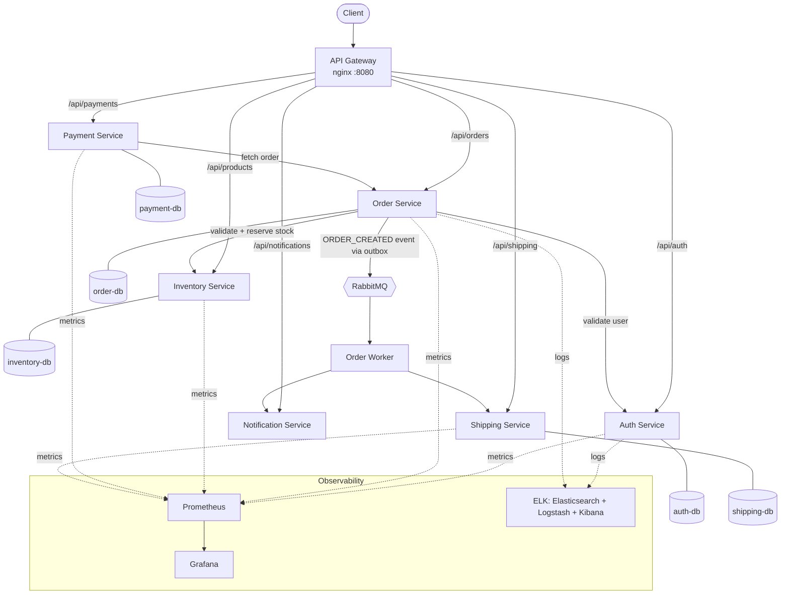

# REST API Backend mini project for an ecommerce web app

Keywords: **REST**, **Docker**, **Mysql**, **K8S**, **Elastic Search**

# Overview
This project was made in the context of a lab for a microservices course. During this lab, i got to learn more about: 
- REST API Design  
- Microservices intercommunication  
- Asynchronous and Event driven Communication  
- Containers with Docker  
- Orchestration with K8s  
- DB design with MySQL  
- Search Architecture with Elastic Search (with logstash and kibana)  
- Fault tolerance patterns (circuit breakers, retry scenarios with backoff, fallback strategies, rate limiting, and timeout management etc.)  

This system manages customers, orders, payments, inventory, shipping, and notifications.

# Summary of the Services created


**API Gateway**: Entry point for all client requests  

**Customer Service**: Manages customer data (authentication)

**Inventory Service**: Handles products stock management

**Order Service**: Handles order creation workflow

**Payment Service**: Processes payments

**Shipping Service**: Manages shipment lifecycle

**Notification Service**: Sends order confirmations

i used Node js for backend, axios for interservices communication, mysql for db, docker compose for local dev of all the services...

## Architecture



**Order flow, end to end:** a client places an order → `order-service` validates the user against `auth-service` and checks stock against `inventory-service` → the order is written along with an outbox event → `order-worker` picks up the event and triggers shipping + notification asynchronously, decoupling order creation from downstream side effects. Payment happens as a separate authenticated call against the order.

## Running it locally

```bash
cp .env.example .env          # fill in local credentials (defaults work for a local demo)

# Generate the internal service-to-service token (order-worker uses this to call
# payment/shipping/order-service on its own behalf). Set JWT_SECRET in .env first,
# then run this with the SAME value:
JWT_SECRET=<same value as in .env> node order-service/generate-service-token.js
# paste the printed token into .env as SERVICE_TOKEN

docker compose up --build
```

- API Gateway: `http://localhost:8080`
- API docs (Swagger UI): `http://localhost:8081`
- Grafana: `http://localhost:3000`
- Kibana: `http://localhost:5601`

## API Documentation

The full API surface (auth, orders, inventory, payments, shipping, notifications) is documented as an [OpenAPI 3.0 spec](./openapi.yaml). With the stack running, browse it interactively at `http://localhost:8081`, or view/edit `openapi.yaml` directly.

## Running the tests

```bash
cd auth-service
npm install
npm test
```

Tests use Jest + Supertest with the database mocked, covering registration validation, login, JWT issuance, and — critically — the authorization rules on every protected route (including regression tests for a couple of bugs found during a security pass: an unauthenticated delete-user endpoint, and password hashes leaking into API responses).

# The workflow used for the tests
used both an admin scenario of tests, and a client one:
1- The client registers (post /auth/register)  
2- Then logs in (post /auth/login)  
3- Sees all the products (get /products)  
4- Checks a specific product (get /products/{productId})  
5- Starts an order for that product (post /orders)  
6- Checks the order status (get /orders/{orderId})  
7- Changes the quantity of the order (put /orders/{orderID})  
8- Pays for the order (post /payments)  
9- Checks the status of the payment (get /payments/{paymentId})  
10- Checks the shipping status (get /shipping)  